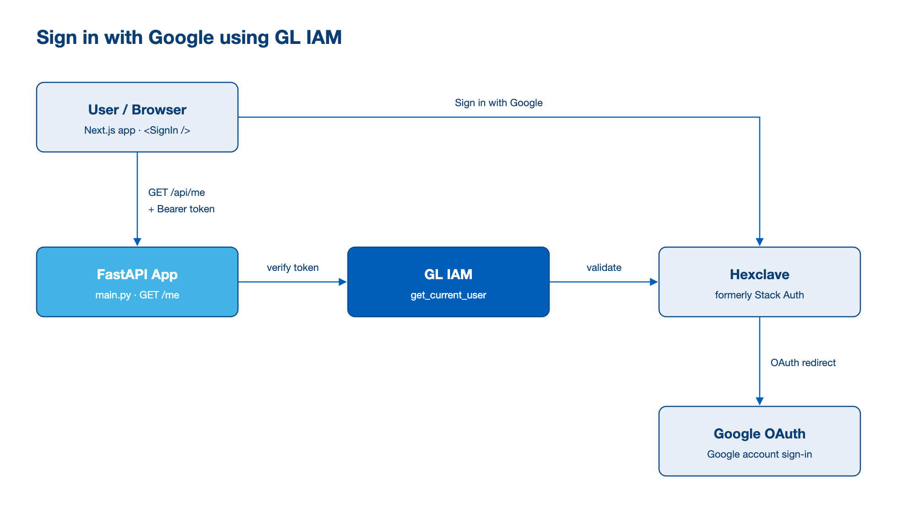
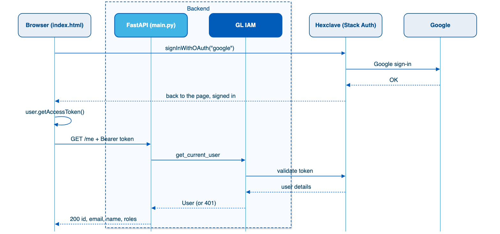

# Sign in with Google — FastAPI + Hexclave (Stack Auth)

> **Error handling v1.2:** This example requires `gl-iam>=0.3.25,<0.4.0`
> from PyPI and Python 3.12 or 3.13. Read the
> [migration and installation notes](../../ERROR_HANDLING.md) before running it.

## Overview

The smallest possible "Sign in with Google" for a FastAPI app: **two files, and no OAuth code**.

| File | What it does |
|---|---|
| [index.html](index.html) | Loads Hexclave's browser SDK. One call, `signInWithOAuth("google")`, signs the user in. |
| [main.py](main.py) | Serves the page, and protects `GET /me` with GL-IAM's `get_current_user`. |

> **Stack Auth is now [Hexclave](https://docs.hexclave.com/)** (`api.hexclave.com`, `@hexclave/*` packages).
> GL-IAM's `StackAuthProvider` works with it unchanged.

The block diagram below shows the components and how they connect: the browser signs in through Hexclave, and FastAPI uses GL IAM to verify the resulting token.



The sequence diagram below walks through one sign-in step by step, from the Google sign-in to the `GET /me` response.



Hexclave handles everything about Google (redirects, callback, creating the user, two-factor).
Your backend only receives a Bearer token, and GL-IAM checks it.

## Prerequisites

Please refer to prerequisites [here](../../README.md).

Additionally, you need:
- A Hexclave project ([app.hexclave.com](https://app.hexclave.com), or self-hosted). Formerly Stack Auth.
- Its **project ID** and **publishable client key** (dashboard → **Project Keys**). No secret key is needed.
- A Google account to sign in with.

## Quick Start

1. **Install dependencies**

   ```bash
   cd gl-iam-cookbook/traditional-iam/fastapi-hexclave-google-signin/
   ./setup.sh        # Windows: setup.bat
   ```

2. **Set up the Hexclave dashboard** (development)

   - **Auth Methods:** turn on **Google**. Keep the shared keys; you don't need a Google Cloud project yet.
   - **Domains:** turn on **Allow all localhost callbacks for development**, or add `http://localhost:8000`.

3. **Fill in `.env`**

   ```bash
   HEXCLAVE_API_URL=https://api.hexclave.com
   HEXCLAVE_PROJECT_ID=your-project-id
   HEXCLAVE_PUBLISHABLE_CLIENT_KEY=pck_your_publishable_key
   ```

4. **Run it**

   ```bash
   uv run main.py
   ```

5. **Sign in**

   Open <http://localhost:8000/> and click **Sign in with Google**. After Google, you land back on
   the page, which calls `GET /me` with your token and shows:

   ```
   GET /me -> 200
   {
     "id": "3f1c...",
     "email": "you@gmail.com",
     "display_name": "Your Name",
     "roles": []
   }
   ```

## Understanding the Code

### index.html: signing in

```js
import { HexclaveClientApp } from "https://esm.sh/@hexclave/js@1.0.137";

const hexclave = new HexclaveClientApp({
  ...HEXCLAVE_SETTINGS,                  // baseUrl, projectId, publishableClientKey (filled in by main.py)
  tokenStore: "cookie",                  // keep the session in a cookie
  urls: { default: { type: "hosted" } }, // Hexclave hosts the sign-in and callback pages
});

const user = await hexclave.getUser();   // null if signed out

hexclave.signInWithOAuth("google");      // sign in: goes to Google, comes back to this page
await user.getAccessToken();             // the token to send to your backend
user.signOut();                          // sign out
```

That is the whole client. This follows Hexclave's
[no-bundler setup](https://docs.hexclave.com/guides/getting-started/setup): the SDK comes from `esm.sh`,
pinned to one version.

- **Want Hexclave's ready-made sign-in page instead of a Google button?** Replace
  `signInWithOAuth("google")` with `redirectToSignIn()`. It shows every method you enabled.

### main.py: protecting endpoints

```python
@app.get("/me")
async def me(user: Annotated[User, Depends(get_current_user)]):
    return {"id": user.id, "email": user.email, "display_name": user.display_name, "roles": user.roles}
```

- `get_current_user` reads `Authorization: Bearer <token>` and asks Hexclave who it belongs to
  (through `StackAuthProvider`). This is the same code as the password example
  [fastapi-stackauth](../fastapi-stackauth/), because GL-IAM doesn't care how the user signed in.
- Add roles with `Depends(require_org_member())` or `Depends(require_org_admin())`, exactly as in that example.
- `GET /` serves `index.html` and replaces `HEXCLAVE_SETTINGS` with the three values from `.env`.
  All three are public. Never put a secret server key in the page.
