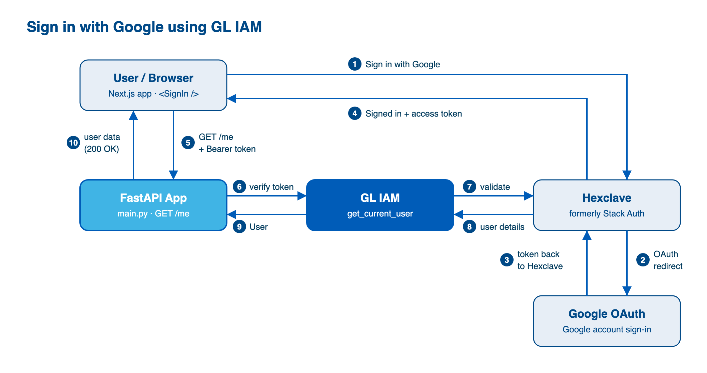
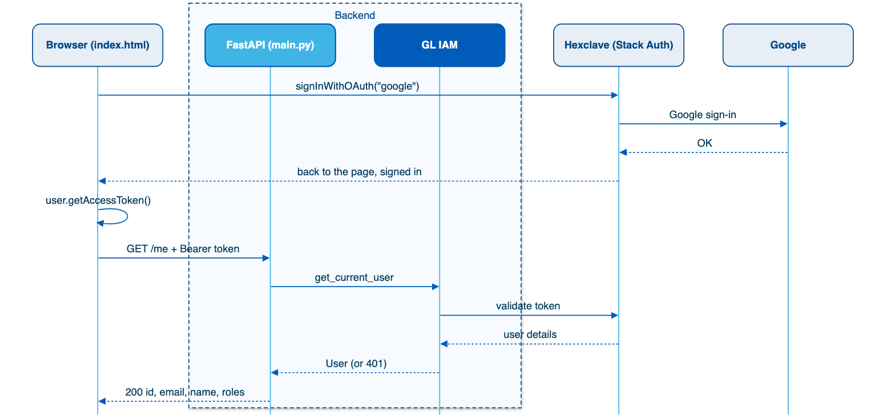

# Sign in with Google — Next.js + FastAPI + Hexclave

Low-code "Sign in with Google": use Hexclave's prebuilt authentication UI for Google sign-in, and keep
GL-IAM responsible for application identity and authorization.

## Overview

- **Hexclave ([web/](web/), Next.js)** owns sign-in: its prebuilt `<SignIn />` component handles the
  Google flow, so there is no OAuth code and no sign-in UI to build.
- **GL-IAM ([main.py](main.py), FastAPI)** owns your API: it validates the token on every protected
  endpoint and resolves the user's identity and roles.





> GL-IAM talks to [Hexclave](https://docs.hexclave.com/) through `StackAuthProvider` (Hexclave was formerly Stack Auth).

## Prerequisites

Please refer to prerequisites [here](../../README.md). Additionally, you need:

- **Node.js 20.12+** (for the Next.js app).
- A Hexclave project ([app.hexclave.com](https://app.hexclave.com)) and its **project ID** and
  **publishable client key** (dashboard → **Project Keys**). No secret key is needed.

## Quick Start

1. **Hexclave dashboard**

   - **Auth Methods:** turn on **Google** (the shared development keys are fine).
   - **Domains:** turn on **Allow all localhost callbacks for development**.

2. **Install** (backend and web app)

   ```bash
   cd gl-iam-cookbook/traditional-iam/fastapi-hexclave-google-signin/
   ./setup.sh        # Windows: setup.bat
   ```

3. **Fill in `.env`**. Both apps read this one file.

   ```bash
   HEXCLAVE_PROJECT_ID=your-project-id
   HEXCLAVE_PUBLISHABLE_CLIENT_KEY=pck_your_publishable_key
   ```

4. **Run** the FastAPI backend (:8000) and the Next.js web app (:3000) together. `Ctrl+C` stops both.

   ```bash
   npx --yes concurrently@9.2.5 "uv run main.py" "npm --prefix web run dev"
   ```

5. **Sign in**: open <http://localhost:3000/>, click **Sign in with Google**. You land back on the home page:

   ```
   GET /me {
     "id": "3f1c...",
     "email": "you@gmail.com",
     "display_name": "Your Name",
     "roles": []
   }
   ```

## Understanding the Code

### web/: Next.js

| File | What it does |
|---|---|
| [app/layout.jsx](web/app/layout.jsx) | Creates the Hexclave app and wraps every page in `HexclaveProvider`. |
| [app/page.jsx](web/app/page.jsx) | Signed out → `<SignIn />`. Signed in → calls `GET /me`. |
| [next.config.mjs](web/next.config.mjs) | Reads `../.env`, and forwards `/api/*` to FastAPI (no CORS needed). |

**Hexclave app** ([app/layout.jsx](web/app/layout.jsx)):

```jsx
const hexclave = new HexclaveClientApp({
  tokenStore: "nextjs-cookie",            // session lives in a cookie
  urls: { default: { type: "hosted" } },  // Hexclave hosts the pages we don't build
});
```

**Signing in and calling the backend** ([app/page.jsx](web/app/page.jsx)):

```jsx
const user = useUser();                      // null when signed out
if (!user) return <SignIn />;                // Hexclave's prebuilt sign-in form

const token = await user.getAccessToken();   // Hexclave access token (a JWT)
fetch("/api/me", { headers: { Authorization: `Bearer ${token}` } });
```

`<SignIn />` shows every method enabled in the dashboard and handles the return from Google itself.

Use `getAccessToken()`, not `getAuthorizationHeader()`: the latter returns a Hexclave-only
`Bearer stackauth_...` value that GL-IAM does not accept.

### main.py: FastAPI + GL-IAM

```python
@app.get("/me")
async def me(user: Annotated[User, Depends(get_current_user)]):
    return {"id": user.id, "email": user.email, "display_name": user.display_name, "roles": user.roles}
```

`get_current_user` reads `Authorization: Bearer <token>` and asks Hexclave who it belongs to (through
`StackAuthProvider`). No token or a bad token returns `401`.
