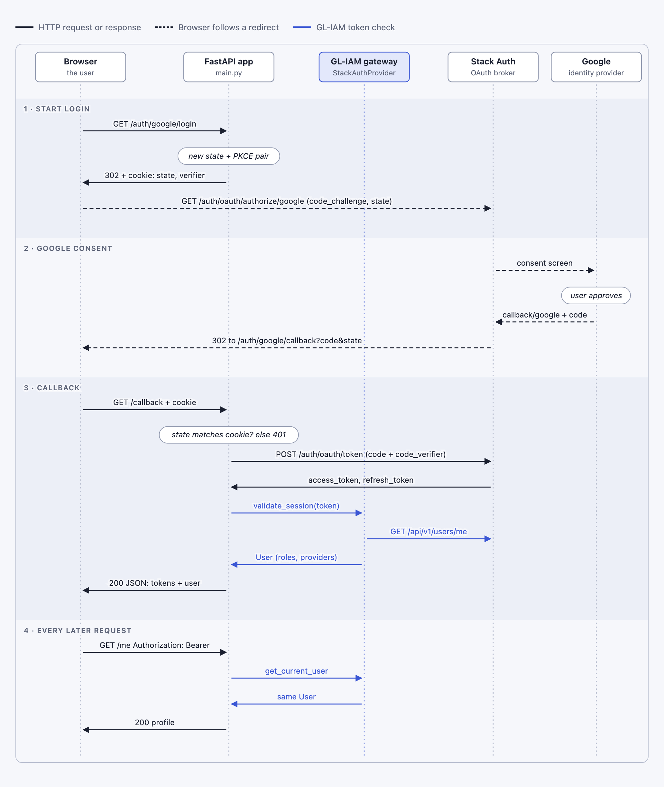

# Sign in with Google — FastAPI + Stack Auth

> **Error handling v1.2:** This example requires `gl-iam>=0.3.25,<0.4.0`
> from PyPI and Python 3.12 or 3.13. SDK failures use canonical
> `error_code`/`message` fields and recovery guidance. Read the
> [migration and installation notes](../../ERROR_HANDLING.md) before running it.

## Overview

This example adds **"Sign in with Google"** to a FastAPI backend using GL-IAM with the
[Stack Auth](https://stack-auth.com/) provider, without a frontend SDK.

- **Stack Auth** brokers the Google OAuth handshake and issues a Stack Auth access token.
- **GL-IAM** validates that token through `StackAuthProvider`. Every protected endpoint uses the same
  `get_current_user` / `require_org_member()` / `require_org_admin()` dependencies as the
  password-based [fastapi-stackauth](../fastapi-stackauth/) example.

That is the SIMI pattern applied to sign-in methods: **how** the user signed in (Google, password,
magic link) doesn't change your endpoint code.



Your app never talks to Google directly. It only sees a Stack Auth code, exchanges it for a Stack Auth
token, and asks GL-IAM who the token belongs to.

The flow is OAuth 2.0 Authorization Code with **PKCE**:

- **`state` cookie:** the callback is accepted only if `state` matches the short-lived HttpOnly
  cookie set at login, which ties it to the browser that started it (CSRF protection).
- **PKCE verifier:** only the challenge leaves the server when the browser is sent to `/authorize/google`. A stolen code is useless
  without the verifier sent to `/auth/oauth/token`.
- **`validate_session`:** the callback checks the new token on the same path as `get_current_user`,
  so protected endpoints don't care how the user signed in.

## Prerequisites

Please refer to prerequisites [here](../../README.md).

Additionally, you need:
- A Stack Auth project (cloud or self-hosted). See [fastapi-stackauth](../fastapi-stackauth/README.md#getting-started) for self-hosting steps.
- Stack Auth API keys: project ID, publishable client key, secret server key
- A Google account to sign in with
- *(Production only)* A Google Cloud OAuth client. In development, Stack Auth's shared Google keys work.

## Quick Start

1. **Open the directory**

   ```bash
   git clone https://github.com/gdplabs/gl-iam-cookbook.git
   cd gl-iam-cookbook/traditional-iam/fastapi-stackauth-google-signin/
   ```

2. **Install dependencies**

   ```bash
   ./setup.sh        # Linux/macOS
   setup.bat         # Windows
   ```

   Or manually: `uv sync && cp .env.example .env`

3. **Enable Google in Stack Auth**

   In the Stack Auth dashboard for your project:

   1. Open **Auth Methods** and turn on **Google**.
   2. **Development:** keep the default **shared keys**. Nothing else is needed. (The consent
      screen shows Stack Auth's branding.)
   3. **Production:** choose **custom keys** and paste your Google **Client ID** and **Client Secret**.
      In [Google Cloud Console → Credentials](https://console.cloud.google.com/apis/credentials),
      create an *OAuth client ID* (type *Web application*). Then add this **Authorized redirect URI**,
      which points at Stack Auth, not at this app:

      ```
      https://api.stack-auth.com/api/v1/auth/oauth/callback/google      # Stack Auth Cloud
      http://localhost:8102/api/v1/auth/oauth/callback/google           # self-hosted dev
      ```

4. **Trust this app's domain in Stack Auth**

   Stack Auth only redirects back to trusted domains. Open **Domains** in the dashboard and either:
   - enable **Allow all localhost callbacks for development**, or
   - add `http://localhost:8000` as a trusted domain (use your real HTTPS domain in production).

5. **Configure `.env`**

   ```bash
   STACKAUTH_BASE_URL=https://api.stack-auth.com       # or http://localhost:8102
   STACKAUTH_PROJECT_ID=your-project-id
   STACKAUTH_PUBLISHABLE_CLIENT_KEY=pck_your_publishable_key
   STACKAUTH_SECRET_SERVER_KEY=ssk_your_secret_key
   APP_BASE_URL=http://localhost:8000                  # public URL of this app
   ```

   The callback URL is derived as `APP_BASE_URL/auth/google/callback`.

6. **Run the server**

   ```bash
   uv run main.py
   ```

7. **Sign in**

   Open <http://localhost:8000/> in a browser and click **Sign in with Google**. After the Google
   consent screen, the callback returns JSON like this:

   ```json
   {
     "access_token": "eyJhbGciOi...",
     "refresh_token": "...",
     "token_type": "bearer",
     "is_new_user": true,
     "user": {
       "id": "3f1c...",
       "email": "you@gmail.com",
       "display_name": "Your Name",
       "avatar_url": "https://lh3.googleusercontent.com/...",
       "roles": [],
       "oauth_providers": ["google"]
     }
   }
   ```

   On first sign-in, Stack Auth creates the user automatically (`is_new_user: true`).

## Testing the API

Copy `access_token` from the callback response:

```bash
export TOKEN="eyJhbGciOi..."

# Health check (public)
curl http://localhost:8000/health

# Start the Google flow (shows the redirect to Stack Auth; finish it in a browser)
curl -i http://localhost:8000/auth/google/login

# Current user (authenticated) - same endpoint as the password example
curl http://localhost:8000/me -H "Authorization: Bearer $TOKEN"

# Member area (requires a team role, see below)
curl http://localhost:8000/member-area -H "Authorization: Bearer $TOKEN"

# Admin area (requires the team admin role)
curl http://localhost:8000/admin-area -H "Authorization: Bearer $TOKEN"
```

Expected results for a new Google user:

| Endpoint | Result |
|---|---|
| `/me` | `200` with profile and `"oauth_providers": ["google"]` |
| `/member-area` | `403` until the user is in a team with a member role |
| `/admin-area` | `403` until the user has the team admin role |
| any endpoint without a token | `401` |

To grant roles, follow
[Team Selection Required for Role Mapping](../fastapi-stackauth/README.md#important-team-selection-required-for-role-mapping):
add the Google user to a team, assign `team_member`/`team_admin` (`$member`/`$admin` on self-hosted),
and make that team the user's selected team. Then sign in again to get a fresh token.

Error cases (try them):

```bash
# Tampered/expired state, or no login cookie -> 401
curl -i "http://localhost:8000/auth/google/callback?code=fake&state=fake"

# User cancelled on the Google consent screen -> 401
curl -i "http://localhost:8000/auth/google/callback?error=access_denied"
```

## Understanding the Code

The example has two files with separate jobs:

| File | Responsibility |
|---|---|
| [google_oauth.py](google_oauth.py) | OAuth plumbing: PKCE, `state`, authorize URL, code exchange. No FastAPI imports, so it can be reused in Django or a CLI. |
| [main.py](main.py) | FastAPI wiring: GL-IAM gateway, the login and callback routes, protected endpoints. |

### 1. Starting the login

```python
@app.get("/auth/google/login")
async def google_login(oauth: StackAuthOAuthClient = Depends(get_oauth_client)):
    pending, pkce = PendingLogin.start()
    url = oauth.authorization_url("google", settings.google_redirect_uri, pending.state, pkce.challenge)
    response = RedirectResponse(url, status_code=302)
    response.set_cookie(PENDING_LOGIN_COOKIE, pending.to_cookie(), httponly=True, samesite="lax", ...)
```

- `PendingLogin.start()` creates a random `state` and a PKCE verifier/challenge pair.
- The **challenge** goes to Stack Auth in the URL. The **verifier** stays in an HttpOnly cookie
  scoped to `/auth/google` and is sent only during the code exchange.
- `samesite="lax"` still sends the cookie on the top-level redirect back from Stack Auth.
- Change `"google"` to `"github"`, `"microsoft"`, and so on to add more providers. The rest of the flow is identical.

### 2. Handling the callback

```python
pending = PendingLogin.from_cookie(pending_cookie)
if pending is None or not pending.matches(state):
    raise AuthenticationError(...)                      # → 401 via add_exception_handlers

tokens = await oauth.exchange_code(code, settings.google_redirect_uri, pending.code_verifier)

result = await gateway.validate_session(tokens.access_token, organization_id=settings.project_id)
if result.is_err:
    raise_for_error(result.error)
```

- `state` is compared in constant time against the cookie, which proves the callback belongs to this browser's login.
- `exchange_code` POSTs to Stack Auth's `/api/v1/auth/oauth/token` with the code and PKCE verifier.
  `redirect_uri` must be identical to the one used in step 1.
- The token is then validated through the **GL-IAM gateway**, the same path `get_current_user`
  uses. The response therefore carries the canonical GL-IAM `User`: roles, permissions, and
  `metadata["oauth_providers"]`.
- Errors are GL-IAM exceptions (`AuthenticationError`, `ProviderUnavailableError`). `add_exception_handlers(app, error_policy="v1.2")`
  maps them to 401/503 with safe bodies. Upstream error text is logged by status code only and never returned.

### 3. Protected endpoints are unchanged

```python
@app.get("/me", response_model=UserResponse)
async def get_me(user: User = Depends(get_current_user)):
    return to_user_response(user)
```

This is the same code as the password example. GL-IAM doesn't care that the token came from Google.

### Stack Auth OAuth endpoints used

| Step | Endpoint | Key params |
|---|---|---|
| Authorize | `GET /api/v1/auth/oauth/authorize/google` | `client_id`=project ID, `client_secret`=publishable key, `redirect_uri`, `state`, `code_challenge`, `code_challenge_method=S256`, `grant_type=authorization_code`, `response_type=code`, `scope=legacy`, `type=authenticate` |
| Exchange | `POST /api/v1/auth/oauth/token` (form) | `grant_type=authorization_code`, `code`, `redirect_uri`, `code_verifier`, `client_id`, `client_secret` |

### Production notes

- **Don't return tokens as JSON to a browser.** Set them as `HttpOnly; Secure; SameSite` cookies and
  redirect to your frontend, or hand them to your SPA through a backend-for-frontend session.
- Use **custom Google keys** (step 3). Shared keys are for development only and don't allow custom scopes.
- Serve over **HTTPS**. Cookies get `Secure` automatically when `APP_BASE_URL` starts with `https://`.
- Stack Auth access tokens are short-lived, and `StackAuthProvider.refresh_session` is a no-op. Refresh
  with the `refresh_token` through Stack Auth (`POST /api/v1/auth/oauth/token` with
  `grant_type=refresh_token`), or let the user sign in again.

### Troubleshooting

| Symptom | Likely cause |
|---|---|
| Stack Auth error page "redirect URL not whitelisted" | Step 4: trust `http://localhost:8000` or allow localhost callbacks |
| Google `redirect_uri_mismatch` | Custom keys: the Google redirect URI must be Stack Auth's callback, not this app's |
| Callback returns `401` immediately | The login cookie is missing or expired (10 min), or you opened the callback in a different browser |
| `/member-area` returns `403` | The Google user has no selected team or role yet (see Testing the API) |

## Next Steps

- [fastapi-stackauth](../fastapi-stackauth/): password sign-in with the same provider and endpoints
- [django-stackauth](../django-stackauth/): Stack Auth with Django
- [rbac-showcase](../rbac-showcase/): switch between Keycloak and Stack Auth with configuration only
- [agent-stackauth](../../agent-iam/agent-stackauth/): delegate a Stack Auth user's access to an AI agent
- [GL-IAM GitBook](https://gdplabs.gitbook.io/sdk/gl-iam) · [Stack Auth OAuth providers](https://docs.stack-auth.com/docs/concepts/auth-providers)
